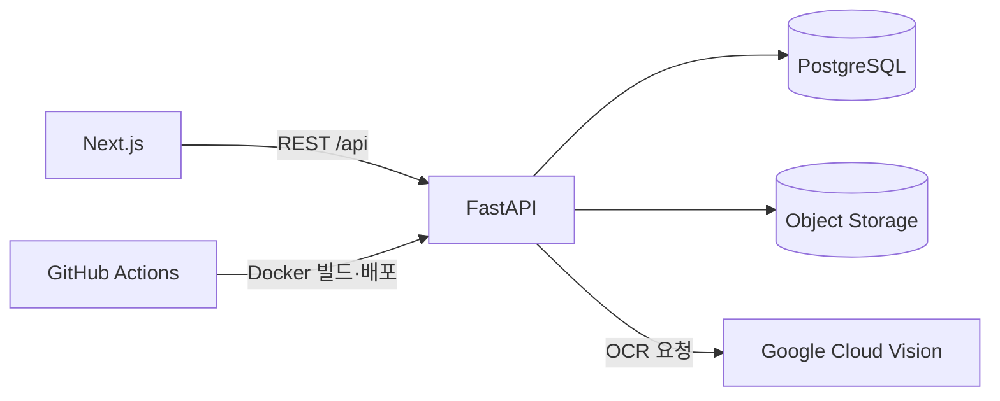
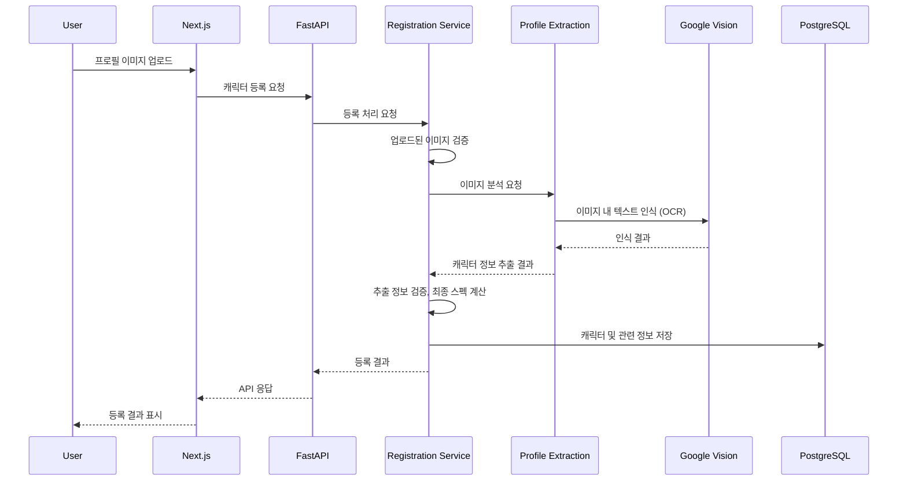

# WaveSync-BE

《명조: 워더링 웨이브》 캐릭터 스펙 계산 웹 서비스의 백엔드(FastAPI) 저장소입니다.

---

## 프로젝트 소개

게임을 실행하지 않고도 캐릭터의 최종 스펙과 에코 정보를 확인할 수 있도록, 프로필 이미지를 분석해 캐릭터 정보를 등록하고 최종 스펙을 계산합니다.

### 게임 도메인

README에 나오는 게임 용어입니다.

| 용어                       | 설명                                                       |
| -------------------------- | ---------------------------------------------------------- |
| 공명자 (Resonator)         | 이 프로젝트의 "캐릭터"에 해당하는 코드 용어                |
| 에코 (Echo)                | 캐릭터에 장착하는 장비 아이템                              |
| 서브속성                   | 에코가 가지는 보조 능력치. 최종 스펙 계산에 반영됨          |
| 무기 재련 단계             | 무기의 강화 단계(1~5). 단계에 따라 무기 효과가 달라짐      |
| 공명 노드 (Resonance Node) | 캐릭터를 강화하는 항목. 활성화한 노드가 최종 스펙에 반영됨 |
| 돌파 (Resonance Chain)     | 캐릭터의 강화 단계 횟수                                    |

### 주요 기능

| 기능             | 설명                                                     | API                                        |
| ---------------- | -------------------------------------------------------- | ------------------------------------------ |
| 게스트 세션 발급 | 쿠키가 없거나 무효하면 새 계정, 있으면 재사용            | `POST /api/auth/session`                   |
| 캐릭터 등록      | 프로필 이미지 분석 후 캐릭터 정보 저장(호출자 소유)      | `POST /api/resonators`                     |
| 캐릭터 목록 조회 | 등록된 캐릭터를 카드 형태로 조회                         | `GET /api/resonators`                      |
| 캐릭터 상세 조회 | 캐릭터, 무기, 최종 스펙 확인                             | `GET /api/resonators/{id}`                 |
| 설정 조회·수정   | 무기 강화 단계·공명 노드 확인과 변경 및 최종 스펙 재계산 | `GET`·`PATCH /api/resonators/{id}/setting` |
| 에코 조회        | 장착한 에코의 주옵션·서브속성 확인                       | `GET /api/resonators/{id}/echo`            |
| 캐릭터 삭제      | 등록된 캐릭터 및 관련 데이터 삭제                        | `DELETE /api/resonators`                   |

---

## 기술 스택과 시스템 구성

| 구분           | 기술                                   | 역할                                                   |
| -------------- | -------------------------------------- | ------------------------------------------------------ |
| Frontend       | Next.js (Vercel 배포)                  | 사용자 인터페이스, 백엔드 API 호출                     |
| Backend        | FastAPI (Docker, Google Cloud Run)     | API 처리, 비즈니스 로직, 데이터 관리                   |
| Database       | PostgreSQL (운영: Supabase)            | 캐릭터 및 관련 데이터 저장                             |
| Object Storage | MinIO (로컬) / Supabase Storage (운영) | 기준 데이터 이미지 저장, 에코 아이콘 매칭용 템플릿 캐시 |
| OCR            | Google Cloud Vision API                | 프로필 이미지 텍스트 추출                              |
| CI/CD          | GitHub Actions                         | `main`의 `fastapi/` 변경 시 이미지 빌드·Cloud Run 배포 |



운영 환경의 DB 연결 정보와 Cloud Run 환경 변수는 이 저장소에 없습니다. 배포 워크플로우는 이미지 빌드와 `gcloud run deploy`만 수행합니다.

---

## 백엔드 구조

백엔드는 캐릭터 도메인과 프로필 이미지 분석을 중심으로 구성되어 있습니다.

`resonator/`는 캐릭터 데이터와 스펙 계산을 담당하는 도메인이고, `user_resonator/`는 사용자가 등록한 캐릭터를 관리합니다.

### 프로젝트 디렉터리

```text
WaveSync-BE/
├── fastapi/
│   ├── app/
│   │   ├── main.py
│   │   ├── config/
│   │   ├── db/
│   │   ├── exceptions/
│   │   ├── schemas/
│   │   ├── storage/
│   │   ├── profile_extraction/
│   │   │   ├── ocr/
│   │   │   └── echo/
│   │   ├── resonator/
│   │   │   ├── router.py
│   │   │   ├── *_service.py
│   │   │   ├── master/
│   │   │   ├── resonance_node/
│   │   │   └── user_resonator/
│   │   ├── auth/
│   │   └── admin/
│   ├── images/template/
│   ├── credentials/
│   ├── .env
│   ├── requirements.txt
│   ├── pyproject.toml
│   └── Dockerfile
│
├── infra/
│   ├── docker-compose.yml
│   └── postgres/
│
└── .github/workflows/
    └── deploy-fastapi.yml
```

### 코드 탐색 가이드

처음 읽는다면 `main.py`에서 앱 구성을 확인한 뒤 `router.py` → `resonator_registration_service.py` 순서로 요청 진입점과 캐릭터 등록 흐름을 확인하는 것을 권장합니다.

이후 수정하려는 기능에 따라 해당 모듈을 확인합니다.

| 작업                    | 우선 확인할 위치                                                                       |
| ----------------------- | --------------------------------------------------------------------------------------- |
| 인증·인가               | `auth/current_user.py`, `auth/session_service.py` + [docs/auth.md](docs/auth.md)        |
| 캐릭터 등록             | `resonator/resonator_registration_service.py`                                           |
| 캐릭터 조회·수정·삭제   | `resonator/resonator_service.py`                                                        |
| 최종 스펙 계산          | `resonator/spec_calculation_service.py`                                                 |
| 이미지 OCR 및 파싱      | `profile_extraction/` + [docs/external-services.md](docs/external-services.md)          |
| API 요청 및 응답 변경   | `resonator/router.py`, `resonator/schemas.py`                                           |
| 데이터 조회 및 저장     | 각 도메인의 `*_repository.py`와 모델 (`master/`, `user_resonator/`)                     |
| 이미지 저장 방식 변경   | `storage/` + [docs/storage.md](docs/storage.md)                                         |

---

## 주요 요청 흐름

### 캐릭터 등록

`POST /api/resonators`



등록 처리는 `resonator/resonator_registration_service.py`의 `create_resonator`가 조율하며, 각 단계의 실제 로직은 다른 모듈에 위임합니다.

추출한 값이 기준 데이터에 없으면 검증 단계에서 등록이 실패합니다.

---

## 인증·인가

로그인·회원가입 없이 사용하는 개인/데모 서비스이므로, 서버가 발급하는 **게스트 세션 쿠키**로 호출자를 식별한다. 모든 캐릭터 데이터는 호출자별로 분리해 관리한다.

| 엔드포인트 | 인증 필요 | CSRF 헤더 | 역할 |
|---|---|---|---|
| `POST /api/auth/session` | 불필요 | 필요 | 게스트 세션 발급 또는 기존 세션 재사용 |
| `GET /api/auth/session` | 필요 | - | 현재 세션의 사용자 ID·역할 조회 |
| `DELETE /api/auth/session` | 필요 | 필요 | 세션 폐기(로그아웃) |
| `GET /api/auth/google/login` | 불필요 | - | Google 로그인 페이지로 이동 |
| `GET /api/auth/google/callback` | 불필요 | - | Google 인증 검증 및 계정 연결 후 프런트로 복귀 |
| `GET /api/admin/master-data` | admin | - | 마스터 데이터 동기화 현황 조회 |
| `GET /api/admin/master-data/{target}/items` | admin | - | 대상별 마스터 데이터 조회 |
| `POST /api/admin/master-data/sync` | admin | 필요 | 외부 API에서 마스터 데이터 동기화 |

게스트 세션·Google 로그인·데이터 소유권·CSRF 방어·관리자 권한의 상세 동작은 [docs/auth.md](docs/auth.md)를 참고하세요.

---

## 로컬 개발 환경

### 사전 요구사항

- Docker 및 Docker Compose v2.24 이상
- Python 3.13
  - 컨테이너 없이 직접 실행하는 경우에만 필요합니다.

### 이미지 저장 방식

데이터 종류별 저장 전략은 [docs/storage.md](docs/storage.md)를 참고하세요.

### 인증 정보

| 항목                       | 위치                                                             | 필수 여부          | 없을 때                        |
| -------------------------- | ---------------------------------------------------------------- | ------------------ | ------------------------------ |
| Vision 서비스 계정 키 파일 | `fastapi/credentials/concrete-flare-495107-c0-0ed9cd7b1ce6.json` | 캐릭터 등록에 필수 | 캐릭터 등록(OCR)이 실패함      |

- Vision 키 파일은 `APP_ENV=dev`일 때 위 경로에서 읽습니다. 그 외 환경에서는 Application Default Credentials를 사용합니다.
- 서버 기동 자체에는 필요하지 않습니다.

### 환경 변수

로컬 실행에 필요한 값은 `infra/docker-compose.yml`에 이미 들어 있습니다. 추가로 설정하는 값은 `fastapi/.env`에 둡니다. 파일이 없어도 실행할 수 있습니다.

| 변수                                   | 위치            | 용도                                          |
| -------------------------------------- | --------------- | --------------------------------------------- |
| `APP_ENV`                              | compose (`dev`) | `dev`는 MinIO, `prod`는 Supabase Storage 사용 |
| `DATABASE_URL`                         | compose         | PostgreSQL 연결 정보                          |
| `MINIO_*`                              | compose         | MinIO 접속 정보와 버킷 이름                   |
| `ADMIN_EMAIL`                           | `fastapi/.env`  | 이 Google 계정으로 로그인하면 자동으로 `admin` 권한 부여 |
| `GOOGLE_CLIENT_ID`, `GOOGLE_CLIENT_SECRET` | `fastapi/.env` | Google 로그인(OAuth 2.0 클라이언트) 인증 정보 |
| `GOOGLE_OAUTH_REDIRECT_URI`            | compose         | Google이 인가 코드를 돌려줄 콜백 URL          |
| `GOOGLE_OAUTH_SUCCESS_REDIRECT_URL`    | compose         | 로그인 완료 후 돌아갈 프론트엔드 주소 (`ALLOWED_ORIGINS`에 포함돼야 함) |
| `SUPABASE_URL`, `SUPABASE_SERVICE_KEY` | 운영 환경       | Supabase Storage 연결 (`APP_ENV=prod`)        |

저장소에 환경 변수 예시 파일은 없습니다.

`fastapi/.env`와 `fastapi/credentials/`는 `fastapi/.gitignore`에 등록되어 Git 추적에서 제외되므로 커밋하지 않습니다.

### 실행

Compose 파일이 `infra/`에 있으므로 해당 폴더에서 실행합니다.

```bash
cd infra
docker compose up
```

| 서비스       | 주소 / 동작                                                                      |
| ------------ | -------------------------------------------------------------------------------- |
| `fastapi`    | `http://localhost:8000` · 코드 변경 시 자동 리로드 · API 명세는 `/docs`에서 확인 |
| `postgres`   | `localhost:5432` · 최초 기동 시 `infra/postgres/*.sql`이 순서대로 실행           |
| `minio`      | API `localhost:9000` · 콘솔 `http://localhost:9001`                              |
| `minio-init` | 버킷 생성 후 종료                                                                |

DB를 초기화하려면 다음 명령으로 볼륨을 삭제한 뒤 다시 실행합니다.

```bash
docker compose down -v
docker compose up
```

초기화 SQL은 DB 볼륨이 비어 있을 때만 실행됩니다.

별도 마이그레이션 도구는 없으므로, 이미 데이터가 있는 DB(볼륨을 비우고 싶지 않은 로컬, 운영 Supabase)에
스키마 변경을 적용해야 하면 `infra/postgres/01_init.sql`을 직접 갱신하고 변경분을 해당 DB에 수동으로
반영합니다.
